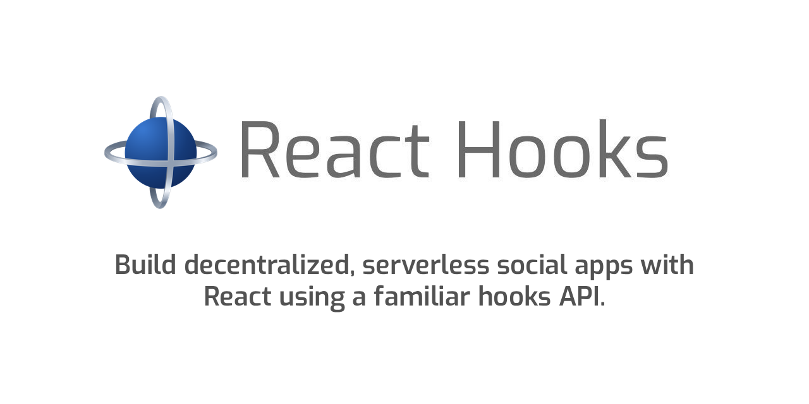
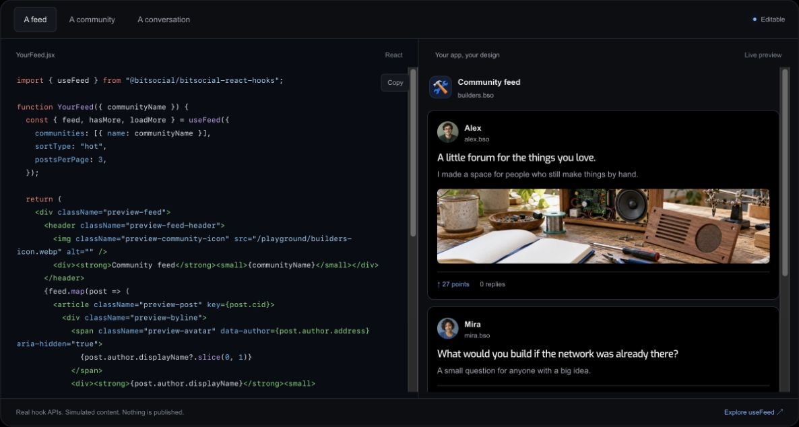

<p align="center">
  
</p>

# Bitsocial React Hooks

<p><strong>Build your corner of the internet.</strong></p>

React hooks for communities, feeds, conversations, profiles, accounts, and publishing on the [Bitsocial protocol](https://bitsocial.net). Bring your own interface; the hooks connect it to shared protocol state through Zustand stores.

[**Documentation**](https://hooks.bitsocial.net/) · [**Try the playground**](https://hooks.bitsocial.net/#playground) · [API & recipes](docs/reference.md) · [npm](https://www.npmjs.com/package/@bitsocial/bitsocial-react-hooks)

[](https://hooks.bitsocial.net/#playground)

*Edit a component and see the result. The playground uses simulated content and publishes nothing.*

Supports **React 16.8+**. Used by [5chan](https://github.com/bitsocialnet/5chan).

## Start building

Add the package to an existing React app:

```bash
yarn add @bitsocial/bitsocial-react-hooks
```

Render this component in the browser with an existing community name:

```jsx
import { useCommunity } from "@bitsocial/bitsocial-react-hooks";

export default function CommunityCard({ name }) {
  const community = useCommunity({ community: { name } });

  if (!community.hasCachedData) {
    return (
      <p role="status">
        {community.error?.message || "Loading community…"}
      </p>
    );
  }

  return (
    <article>
      <h1>{community.title || name}</h1>
      <p>{community.description}</p>
    </article>
  );
}
```

The package initializes a local account automatically. You can also identify a community with `{ publicKey }`, or pass both `{ name, publicKey }`. Hooks share cached data and subscriptions; use `syncState` when you need to show background refresh progress.

## Explore the docs

Read the guides at [hooks.bitsocial.net](https://hooks.bitsocial.net/), or browse their source here:

- [Quickstart](website/content/quickstart.md) — build your first feed.
- [Core concepts](website/content/concepts.md) — communities, accounts, state, and publishing.
- [Full API and recipes](docs/reference.md) — the complete hook reference and practical examples.
- [Mock content](docs/mock-content.md) — develop a UI with sample data.
- [AI context](website/content/ai.md), [llms.txt](llms.txt), and [llms-full.txt](llms-full.txt) — documentation for your coding assistant.

### Run the website locally

The site lives in [`website/`](website/README.md). To open the playground and docs in your browser:

```bash
cd website
corepack yarn install --immutable
corepack yarn start
```

## Contribute

Use Node 22.19 or newer and the repository's pinned Yarn 4 release:

```bash
nvm install
nvm use
corepack yarn install
corepack yarn build
```

Read [testing and development](docs/testing.md), [contributor guidance](AGENTS.md), and [verification](docs/agent-playbooks/verification.md) for focused checks. Keep API examples aligned with the public exports and types; after documentation changes, run `corepack yarn llms:generate`.

## License

[GPL-3.0-or-later](LICENSE).
